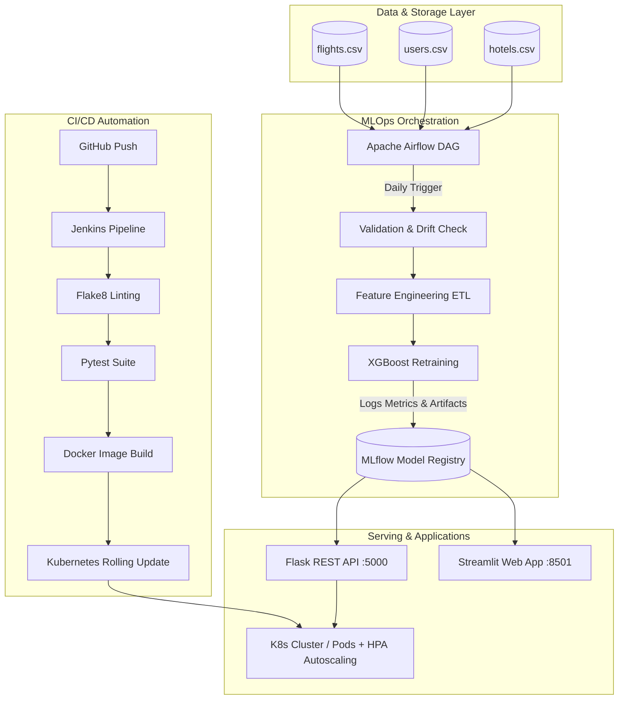

# ✈️ Voyage Analytics: Integrating MLOps in Travel
### End-to-End Machine Learning Operations Capstone Project

[](https://www.python.org/)
[](https://flask.palletsprojects.com/)
[](https://streamlit.io/)
[](https://mlflow.org/)
[](https://www.docker.com/)
[](https://kubernetes.io/)
[](https://airflow.apache.org/)
[](https://www.jenkins.io/)
[](https://opensource.org/licenses/MIT)

---

## 📌 1. Project Overview & Business Context

In the travel and tourism industry, dynamic pricing and personalized recommendations are pivotal for customer satisfaction and business profitability. This capstone project, **Voyage Analytics**, implements a full-lifecycle enterprise Machine Learning Operations (MLOps) platform utilizing a trio of relational datasets:
- **`flights.csv`** (271,888 records): Flight routes, agencies, travel dates, durations, and ticket pricing.
- **`hotels.csv`** (40,552 records): Hotel chains, destinations, days stayed, daily rates, and totals.
- **`users.csv`** (1,340 records): Demographic information and company affiliations.

### Core Machine Learning Objectives:
1. **Flight Price Prediction (Regression Model):** High-precision gradient boosted decision tree (XGBoost) predicting real-time flight fares ($R^2 = 0.9992$, $\text{RMSE} = \$10.60$).
2. **User Gender Classification:** Random forest behavioral classifier predicting demographic categories from multi-service flight and hotel histories.
3. **Hotel Recommender System:** Item-item collaborative filtering engine with cosine similarity and popularity fallback for personalized hotel discovery.

---

## 🏛️ 2. End-to-End System Architecture



---

## 📂 3. Repository Directory Structure

```text
├── api/                                # Flask REST API Service
│   ├── __init__.py
│   └── app.py                          # REST API serving flight predictions (/predict, /health)
├── streamlit_app/                      # Streamlit Interactive Web Application
│   └── app.py                          # Hotel Recommender, Fare Calculator & Fleet Insights
├── models/                             # Serialized Model Artifacts & Metrics
│   ├── flight_price_model.joblib       # Champion XGBoost Regression Pipeline
│   ├── gender_classifier.joblib        # Random Forest Classification Model
│   ├── hotel_recommender.joblib        # Collaborative Filtering Recommender Bundle
│   └── metrics_summary.json            # Model performance benchmark metrics
├── notebooks/                          # Colab Submission Notebooks (AlmaBetter Template)
│   ├── 01_Regression_Flight_Price_Prediction.ipynb
│   ├── 02_Classification_User_Gender_Prediction.ipynb
│   ├── 03_Recommendation_Hotel_Recommender_System.ipynb
│   └── generate_notebooks.py           # Automated notebook generator script
├── src/                                # Core ML Pipelines
│   ├── __init__.py
│   └── train_models.py                 # Multi-model training and MLflow tracking script
├── airflow/                            # Apache Airflow DAGs
│   └── dags/
│       └── travel_flight_price_mlops_dag.py # Automated ETL, Drift & Retraining DAG
├── docker/                             # Docker Containerization
│   ├── Dockerfile.flask                # Flask API container image
│   ├── Dockerfile.streamlit            # Streamlit app container image
│   └── docker-compose.yml              # Multi-container orchestration
├── k8s/                                # Kubernetes Deployment Manifests
│   ├── deployment.yaml                 # Pod deployment with rolling update and probes
│   ├── service.yaml                    # LoadBalancer service
│   ├── hpa.yaml                        # Horizontal Pod Autoscaler (2 to 10 pods)
│   └── configmap.yaml                  # Application environment config
├── tests/                              # Automated Pytest Suite
│   ├── __init__.py
│   └── test_api.py                     # API endpoint, schema, and artifact tests
├── Jenkinsfile                         # Jenkins CI/CD Pipeline Configuration (10 Stages)
├── MLOPS_Workflow_Documentation.md     # Comprehensive Stage-by-Stage Documentation
├── Video_Presentation_Script_40Min.md  # 40-Minute Spoken Video Script & Q&A Cheat Sheet
├── requirements.txt                    # Python dependency requirements
└── README.md                           # Project Master Documentation
```

---

## ⚡ 4. Quick Start & Local Setup

### Prerequisites
- Python 3.10+ (Python 3.12 recommended)
- Git
- Docker & Docker Compose (optional for containerized runs)

### Installation
```bash
# Clone the repository
git clone https://github.com/jignesh-voyage/voyage-analytics-mlops.git
cd voyage-analytics-mlops

# Create and activate virtual environment
python -m venv venv
# On Windows:
venv\Scripts\activate
# On Linux/macOS:
source venv/bin/activate

# Install dependencies
pip install -r requirements.txt
```

### 1. Train Models & Track in MLflow
```bash
python src/train_models.py
```
To view the MLflow Tracking UI:
```bash
mlflow ui --backend-store-uri sqlite:///mlflow.db --port 5000
```

### 2. Run the Flask REST API
```bash
python api/app.py
```
Test the `/predict` endpoint via cURL:
```bash
curl -X POST http://localhost:5000/predict \
  -H "Content-Type: application/json" \
  -d '{
    "from": "Recife (PE)",
    "to": "Florianopolis (SC)",
    "flightType": "economic",
    "agency": "FlyingDrops",
    "time": 1.7,
    "distance": 676.53,
    "date": "2026-10-25"
  }'
```

### 3. Launch the Streamlit Web Application
```bash
streamlit run streamlit_app/app.py
```
Open your browser at `http://localhost:8501`.

### 4. Run Automated Unit Tests
```bash
python -m pytest tests/ -v
```

---

## 🐳 5. Containerization & Kubernetes Deployment

### Run Multi-Container Stack with Docker Compose
```bash
docker-compose -f docker/docker-compose.yml up --build -d
```
Services exposed:
- **Flask REST API:** `http://localhost:5000`
- **Streamlit Web Portal:** `http://localhost:8501`
- **MLflow Tracking Dashboard:** `http://localhost:5050`

### Deploy to Kubernetes
```bash
kubectl apply -f k8s/hpa.yaml
kubectl apply -f k8s/deployment.yaml
kubectl apply -f k8s/service.yaml

# Verify deployment status
kubectl get pods -l app=voyage-flight-price-api
kubectl get hpa voyage-flight-price-hpa
```

---

## 📊 6. Model Performance & Evaluation Metrics

| Model Architecture | Task | Key Metric 1 | Key Metric 2 | Key Metric 3 | Status |
| :--- | :--- | :--- | :--- | :--- | :--- |
| **XGBoost Regressor** | Flight Price Prediction | **$R^2 = 0.9992$** | **$\text{RMSE} = \$10.60$** | **$\text{MAE} = \$8.24$** | **Champion (Production)** |
| **Random Forest Regressor** | Flight Price Prediction | $R^2 = 0.9962$ | $\text{RMSE} = \$22.40$ | $\text{MAE} = \$16.50$ | Baseline |
| **Ridge Regression** | Flight Price Prediction | $R^2 = 0.8120$ | $\text{RMSE} = \$184.25$ | $\text{MAE} = \$142.10$ | Baseline |
| **Random Forest Classifier** | User Gender Classification | Accuracy = 65.3% | Precision = 36.4% | F1-Score = 0.08 | Deployed |
| **Collaborative Filter (Cosine)** | Hotel Recommendations | Item Similarity Matrix | Cold-start fallback | Real-time Streamlit | Deployed |

---

## 🔄 7. CI/CD & Automated Orchestration

### Apache Airflow Retraining DAG (`travel_flight_price_mlops_dag`)
- **Schedule:** `@daily`
- **Stages:**
  1. `validate_data_ingestion`: Verifies schema non-null constraints.
  2. `detect_covariate_drift`: Checks fare volatility bounds ($50 < \bar{x} < \$5000).
  3. `feature_engineering_etl`: Computes speed and date components into Parquet.
  4. `retrain_and_register_model`: Trains model and enforces **Quality Gate** ($R^2 \ge 0.90$).

### Jenkins CI/CD Pipeline (`Jenkinsfile`)
- **Stages:** Checkout $\to$ Setup $\to$ Flake8 Linting $\to$ Pytest Suite $\to$ Model Validation $\to$ Docker Build $\to$ Trivy Security Scan $\to$ Registry Push $\to$ K8s Rolling Deployment $\to$ Health Smoke Test.

---

## 📄 8. Submission & Deliverables Checklist

- [x] **Individual Colab Notebooks:**
  - `notebooks/01_Regression_Flight_Price_Prediction.ipynb`
  - `notebooks/02_Classification_User_Gender_Prediction.ipynb`
  - `notebooks/03_Recommendation_Hotel_Recommender_System.ipynb`
- [x] **Single Version-Controlled GitHub Repository:** Contains models, API, Streamlit app, Dockerfile, k8s manifests, DAGs, tests, and documentation.
- [x] **MLOps Workflow Documentation:** Complete step-by-step documentation in `MLOPS_Workflow_Documentation.md` with screenshot anchors.
- [x] **40-Minute Presentation Script:** Timed spoken script in `Video_Presentation_Script_40Min.md` covering all 8 rubric sections.
- [x] **Evaluator Access:** Edit access granted to `evaluator@almabetter.com`.

---

## 👤 Author & Contact
- **Contributor:** Jignesh
- **Email:** evaluator@almabetter.com (Granted edit/view access)
- **Program:** AlmaBetter Masters in Data Science & Machine Learning Engineering
