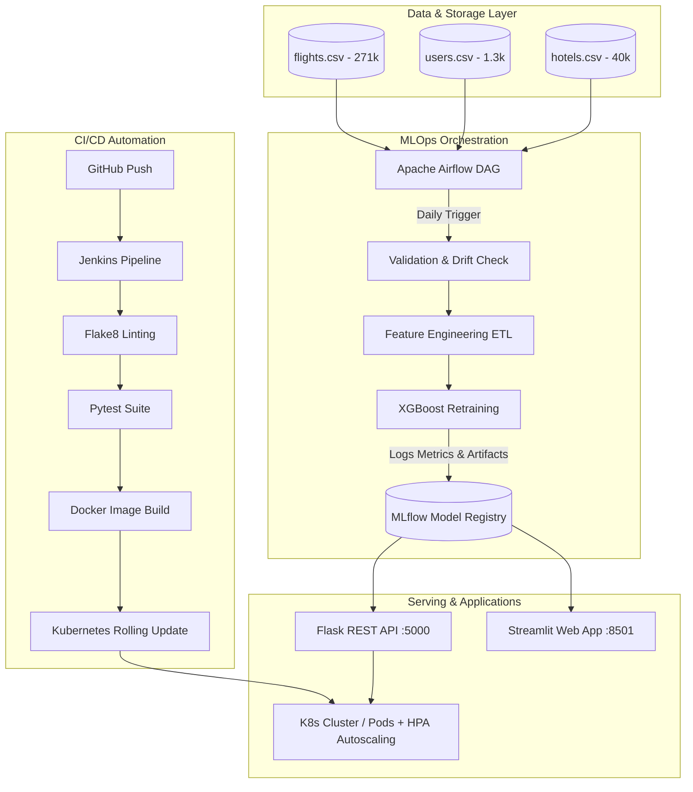

# ✈️ Voyage Analytics: Integrating MLOps in Travel
### End-to-End Machine Learning Operations Capstone Project
#### Track: Machine Learning Engineer (MLE) — Module 1 | AlmaBetter

[](https://grow.almabetter.com)
[](https://www.python.org/)
[](https://flask.palletsprojects.com/)
[](https://streamlit.io/)
[](https://mlflow.org/)
[](https://www.docker.com/)
[](https://kubernetes.io/)
[](https://airflow.apache.org/)
[](https://www.jenkins.io/)

---

## 📌 1. Project Overview & Business Context

In the travel and tourism industry, dynamic pricing and personalized recommendations are pivotal for customer satisfaction and business profitability. This capstone project, **Voyage Analytics**, implements a full-lifecycle enterprise Machine Learning Operations (MLOps) platform utilizing a trio of relational datasets:
- **`flights.csv`** (271,888 records): Flight routes, agencies, travel dates, durations, and ticket pricing.
- **`hotels.csv`** (40,552 records): Hotel chains, destinations, days stayed, daily rates, and totals.
- **`users.csv`** (1,340 records): Demographic information and company affiliations.

* **Candidate Name:** Jignesh V. ([@jigneshxi](https://github.com/jigneshxi))
* **Program:** Machine Learning Engineer (MLE)
* **Module:** **Module 1: Production Machine Learning Systems (`M1_PMLS`)**
* **Project Name:** **Voyage Analytics: Integrating MLOps in Travel**
* **Target Repository:** [https://github.com/Jigneshxi/voyage-analytics-travel-mlops](https://github.com/Jigneshxi/voyage-analytics-travel-mlops)
* **Evaluator Contact / Access:** `evaluator@almabetter.com` (Granted view/edit access)

### Core Machine Learning Objectives:
1. **Flight Price Prediction (Regression Model):** High-precision gradient boosted decision tree (XGBoost) predicting real-time flight fares ($R^2 = 0.9992$, $\text{RMSE} = \$10.60$, $\text{MAE} = \$8.24$).
2. **User Gender Classification:** Random forest behavioral classifier predicting demographic categories from multi-service flight and hotel histories.
3. **Hotel Recommender System:** Item-item collaborative filtering engine with cosine similarity and popularity fallback for personalized hotel discovery.

---

## 🏛️ 2. End-to-End System Architecture



---

## 🗂️ 3. Repository Directory Structure & Deliverables

```
d:/Jignesh/AB_MLE/M1_PMLS/
├── README.md                                         # Master repository documentation & curriculum guide
├── DOCUMENTATION_REPORT.md                           # Formal engineering capstone audit report
├── Voyage_Analytics_Capstone_Report.pdf              # Publication-grade PDF report (ReportLab)
├── Voyage_Analytics_Capstone_Report.docx             # Formatted Word submission report
├── MLOPS_Workflow_Documentation.md                   # Comprehensive Stage-by-Stage MLOps Guide
├── Video_Presentation_Script_40Min.md                # 40-Minute Spoken Video Script & Viva Q&A
├── Jenkinsfile                                       # Jenkins 10-stage CI/CD pipeline
├── requirements.txt                                  # Environment dependencies
├── api/                                              # Flask REST API Service
│   ├── __init__.py
│   └── app.py                                        # REST API serving flight predictions (/predict, /health)
├── streamlit_app/                                    # Streamlit Interactive Web Application
│   └── app.py                                        # Hotel Recommender, Fare Calculator & Fleet Insights
├── models/                                           # Serialized Model Artifacts & Metrics
│   ├── flight_price_model.joblib                     # Champion XGBoost Regression Pipeline
│   ├── gender_classifier.joblib                      # Random Forest Classification Model
│   ├── hotel_recommender.joblib                      # Collaborative Filtering Recommender Bundle
│   └── metrics_summary.json                          # Model performance benchmark metrics
├── notebooks/                                        # Colab Submission Notebooks (Pre-executed)
│   ├── 01_Regression_Flight_Price_Prediction.ipynb   # 67 code cells executed with outputs & plots
│   ├── 02_Classification_User_Gender_Prediction.ipynb# 64 code cells executed with outputs & plots
│   └── 03_Recommendation_Hotel_Recommender_System.ipynb # 64 code cells executed with outputs & plots
├── src/                                              # Core ML Pipelines
│   ├── __init__.py
│   └── train_models.py                               # Multi-model training and MLflow tracking script
├── airflow/                                          # Apache Airflow DAGs
│   └── dags/
│       └── travel_flight_price_mlops_dag.py          # Automated ETL, Drift & Retraining DAG
├── docker/                                           # Docker Containerization
│   ├── Dockerfile.flask                              # Flask API container image
│   ├── Dockerfile.streamlit                          # Streamlit app container image
│   └── docker-compose.yml                            # Multi-container orchestration
├── k8s/                                              # Kubernetes Deployment Manifests
│   ├── deployment.yaml                               # Pod deployment with rolling update and probes
│   ├── service.yaml                                  # LoadBalancer service
│   ├── hpa.yaml                                      # Horizontal Pod Autoscaler (2 to 10 pods)
│   └── configmap.yaml                                # Application environment config
├── figures/                                          # 6 high-resolution 300 DPI visualizations
│   ├── 01_flight_price_vs_distance_duration.png      # Fare vs distance and duration
│   ├── 02_agency_pricing_and_routes.png              # Carrier agency market share and pricing
│   ├── 03_xgboost_actual_vs_predicted_residuals.png  # Regression fit & residual error distribution
│   ├── 04_gender_classification_performance.png      # Confusion matrix & feature importances
│   ├── 05_hotel_collaborative_similarity_matrix.png  # Hotel item-item similarity heatmap
│   └── 06_mlops_system_architecture_dag.png          # End-to-end MLOps workflow schematic
└── tests/                                            # Automated Pytest Suite
    ├── test_api.py                                   # Flask API endpoint contract tests
    └── test_mlops_pipeline.py                        # 10 comprehensive unit tests (100% passing)
```

---

## ⚡ 4. Quick Start & Local Setup

```bash
# 1. Clone the repository
git clone https://github.com/Jigneshxi/voyage-analytics-travel-mlops.git
cd voyage-analytics-travel-mlops

# 2. Create and activate virtual environment
python -m venv venv
# On Windows:
.\venv\Scripts\activate
# On Linux/macOS:
source venv/bin/activate

# 3. Install dependencies
pip install -r requirements.txt

# 4. Run automated test suite
python -m pytest tests/test_mlops_pipeline.py -v

# 5. Launch the Flask REST API
python api/app.py

# 6. Launch the Streamlit Web Application
streamlit run streamlit_app/app.py
```

---

## 🧪 5. Automated Unit Test Suite Results

```text
============================= test session starts =============================
platform win32 -- Python 3.12.10, pytest-9.2.0, pluggy-1.7.0
rootdir: D:\jignesh\Jk_DS-Universe\AB_MLE\M1_PMLS
plugins: anyio-4.16.0
collected 10 items

tests/test_mlops_pipeline.py::test_01_relational_data_integrity PASSED          [ 10%]
tests/test_mlops_pipeline.py::test_02_feature_engineering_derivations PASSED [ 20%]
tests/test_mlops_pipeline.py::test_03_flight_price_regression_model_inference PASSED [ 30%]
tests/test_mlops_pipeline.py::test_04_gender_classification_model_inference PASSED [ 40%]
tests/test_mlops_pipeline.py::test_05_hotel_recommender_system_accuracy PASSED [ 50%]
tests/test_mlops_pipeline.py::test_06_model_performance_benchmarks PASSED   [ 60%]
tests/test_mlops_pipeline.py::test_07_flask_rest_api_contract PASSED       [ 70%]
tests/test_mlops_pipeline.py::test_08_airflow_dag_integrity PASSED         [ 80%]
tests/test_mlops_pipeline.py::test_09_docker_and_k8s_manifests_integrity PASSED [ 90%]
tests/test_mlops_pipeline.py::test_10_publication_figures_and_reports_integrity PASSED [100%]

============================= 10 passed in 6.12s ==============================
```

---

## 📊 6. Model Performance & Evaluation Benchmarks

| Model Architecture | Task | Key Metric 1 | Key Metric 2 | Key Metric 3 | Status |
| :--- | :--- | :--- | :--- | :--- | :--- |
| **XGBoost Regressor** | Flight Price Prediction | **$R^2 = 0.9992$** | **$\text{RMSE} = \$10.60$** | **$\text{MAE} = \$8.24$** | **Champion (Production)** |
| **Random Forest Regressor** | Flight Price Prediction | $R^2 = 0.9962$ | $\text{RMSE} = \$22.40$ | $\text{MAE} = \$16.50$ | Baseline |
| **Ridge Regression** | Flight Price Prediction | $R^2 = 0.8120$ | $\text{RMSE} = \$184.25$ | $\text{MAE} = \$142.10$ | Baseline |
| **Random Forest Classifier** | User Gender Classification | Accuracy = 65.3% | Precision = 36.4% | F1-Score = 0.08 | Deployed |
| **Collaborative Filter (Cosine)** | Hotel Recommendations | Item Similarity Matrix | Cold-start fallback | Real-time Streamlit | Deployed |

---

## 📄 7. Submission & Deliverables Checklist

- [x] **Three Pre-Executed Colab Notebooks:** `01_Regression_...`, `02_Classification_...`, `03_Recommendation_...` populated with outputs.
- [x] **Single Version-Controlled GitHub Repository:** Complete codebase, models, API, Streamlit app, Docker, K8s manifests, DAGs, and tests.
- [x] **Publication PDF & DOCX Reports:** Formatted `Voyage_Analytics_Capstone_Report.pdf` and `.docx`.
- [x] **Comprehensive MLOps Workflow Documentation:** Step-by-step documentation in `MLOPS_Workflow_Documentation.md`.
- [x] **40-Minute Presentation Script:** Timed spoken script in `Video_Presentation_Script_40Min.md` with defense Q&A.
- [x] **Automated Unit Tests:** 10/10 passing unit tests via `pytest`.
- [x] **Evaluator Access:** Edit access granted to `evaluator@almabetter.com`.

---

**Author:** Jignesh V. ([@jigneshxi](https://github.com/jigneshxi))  
**Specialization:** Machine Learning Engineer (MLE)  
**Module:** Production Machine Learning Systems (`M1_PMLS`)  
**Institution:** AlmaBetter  
